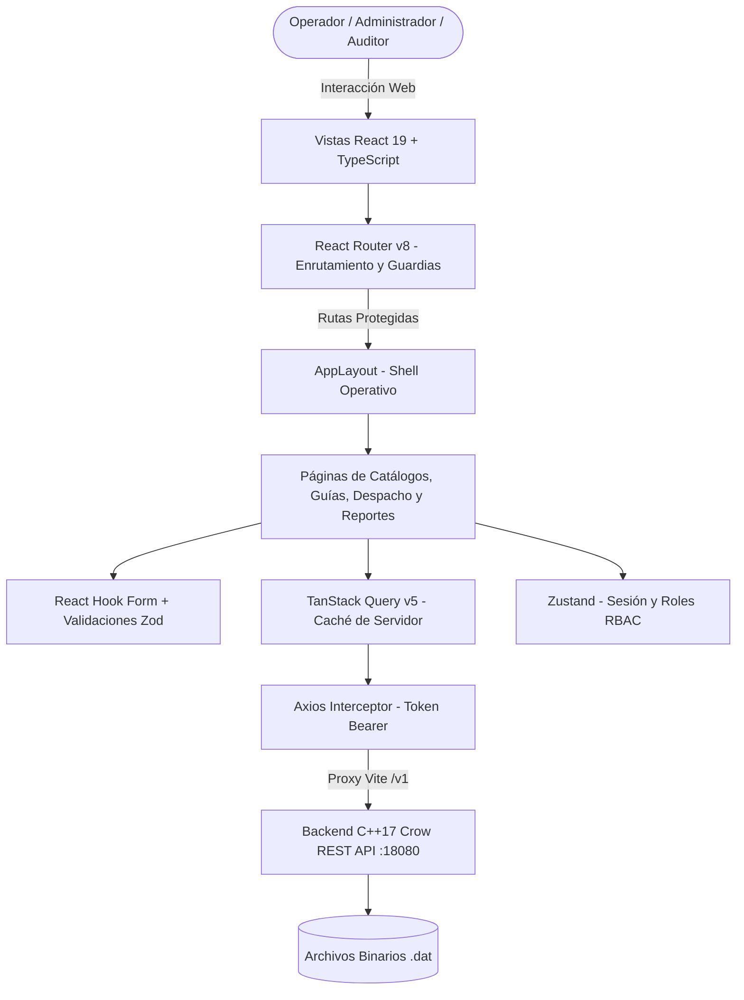

# Arquitectura de Software — UMG Express Frontend

**Universidad Mariano Gálvez de Guatemala (UMG)**  
**Facultad de Ingeniería en Sistemas de Información y Ciencias de la Computación**  
**Proyecto Académico — Sistema de Gestión Logística y Paquetería**

---

## 1. Visión General del Sistema

El frontend de **UMG Express** es una aplicación web de una sola página (**Single Page Application - SPA**) de alto rendimiento, diseñada para operar como el cliente visual y operativo del sistema de control logístico. Se conecta de forma directa y asíncrona a la API REST de alto rendimiento desarrollada en **C++17 (Crow)** sobre `http://127.0.0.1:18080`.

La arquitectura del frontend está concebida bajo principios de desacoplamiento modular, inmutabilidad de datos, tipado estático riguroso y una experiencia de usuario sobria, eficiente y densa en información, siguiendo el estándar de diseño **admin-ui** para herramientas operativas industriales.



---

## 2. Tecnologías Clave y Justificación

| Tecnología | Versión | Propósito Arquitectónico |
| :--- | :--- | :--- |
| **React** | 19.2.8 | Biblioteca de interfaz declarativa, renderizado reactivo eficiente y concurrencia. |
| **TypeScript** | 6.0.2 (~6.0) | Tipado estático estricto que modela exactamente las estructuras binarias del backend. |
| **Vite** | 8.3.0 | Empaquetador ultra-rápido con Hot Module Replacement (HMR) y proxy reverso integrado. |
| **TanStack Query** | 5.104.2 | Gestión del estado asíncrono del servidor, caché determinista, refetching e invalidación. |
| **Zustand** | 5.0.15 | Almacén de estado global liviano con persistencia automática de sesión en `localStorage`. |
| **React Router** | 8.4.0 | Enrutamiento cliente con guardias de autenticación (`ProtectedRoute`) y roles (`RoleGuard`). |
| **Tailwind CSS** | 4.3.3 | Motor de utilidades CSS moderno configurado con tokens de diseño industrial oscuro. |
| **Lucide React** | 1.55.0 | Conjunto de iconos vectoriales consistentes y sobrios para logística y gestión de datos. |
| **Sonner** | 2.0.8 | Sistema de notificaciones no intrusivas (*toasts*) para retroalimentación operativa. |
| **Zod + React Hook Form** | 4.6 / 7.90 | Validación declarativa de formularios en tiempo de digitación. |

---

## 3. Estructura de Directorios del Proyecto

El código fuente se organiza bajo una estructura modular orientada a responsabilidades claras dentro de `src/`:

```text
umg_express_react/
├── index.html                   # Contenedor HTML principal y metadatos SEO
├── package.json                 # Dependencias y scripts de ejecución
├── tsconfig.json                # Configuración de TypeScript y paths (@/*)
├── vite.config.ts               # Configuración de Vite, plugins y proxy /v1
├── public/                      # Recursos estáticos servidos directamente
├── src/
│   ├── main.tsx                 # Punto de entrada de la aplicación y Providers (Query, Auth)
│   ├── App.tsx                  # Componente raíz con enrutador y notificador Toaster
│   ├── index.css                # Sistema de diseño, variables CSS y reset tipográfico
│   ├── api/                     # Capa de comunicación REST y servicios modulares
│   │   ├── client.ts            # Instancia Axios con interceptores de autorización y errores
│   │   ├── auth.ts              # Endpoints de login y administración de usuarios
│   │   ├── catalogos.ts         # CRUDs: sucursales, clientes, rutas, vehículos, pilotos, tarifas
│   │   ├── guias.ts             # Emisión y consulta de guías de envío
│   │   ├── despacho.ts          # Asignación y despacho de vehículos con guías
│   │   └── reportes.ts          # Rastreo integral, manifiestos y liquidación financiera
│   ├── components/              # Componentes de interfaz de usuario reutilizables
│   │   ├── layout/              # Estructura visual de navegación y guardias
│   │   │   ├── AppLayout.tsx    # Shell con Sidebar colapsable y Topbar fijo
│   │   │   ├── Sidebar.tsx      # Menú lateral estructurado por grupos de operaciones
│   │   │   ├── Topbar.tsx       # Barra superior con datos del usuario, rol y logout
│   │   │   ├── ProtectedRoute.tsx # Guardia que exige sesión activa
│   │   │   └── RoleGuard.tsx    # Guardia que restringe vistas según rol (RBAC)
│   │   └── ui/                  # Componentes atómicos de diseño industrial
│   │       ├── Badge.tsx        # Indicadores de estado (Registrada, Despachada, Disponible, etc.)
│   │       ├── Button.tsx       # Botones primarios, secundarios, neutros y de peligro
│   │       ├── CapacityBar.tsx  # Barras visuales de capacidad de peso (kg) y volumen (m³)
│   │       ├── Card.tsx         # Contenedores de paneles con fondo #18191d y borde #26282e
│   │       ├── Input.tsx        # Campos de texto y numéricos con soporte tabular
│   │       ├── Modal.tsx        # Diálogos modales accesibles para confirmaciones y formularios
│   │       ├── Select.tsx       # Menús desplegables estilizados
│   │       └── StatCard.tsx     # Tarjetas de indicadores numéricos (KPIs)
│   ├── lib/                     # Utilidades matemáticas y lógica de dominio logístico
│   │   ├── calculos.ts          # Fórmulas de peso volumétrico, peso facturable y costos
│   │   └── utils.ts             # Formateadores monetarios (Quetzales Q), peso (kg) y volumen (m³)
│   ├── pages/                   # Vistas principales de la aplicación organizadas por dominio
│   │   ├── auth/                # Login y autenticación
│   │   │   └── LoginPage.tsx
│   │   ├── dashboard/           # Panel de control ejecutivo y resumen de actividad
│   │   │   └── DashboardPage.tsx
│   │   ├── transacciones/       # Operaciones del día a día
│   │   │   ├── GuiasPage.tsx    # Emisión de guías y cálculo volumétrico en vivo
│   │   │   └── DespachoPage.tsx # Control de capacidad y despacho vehicular
│   │   ├── reportes/            # Consultas operativas y financieras
│   │   │   ├── RastreoPage.tsx  # Búsqueda y línea de tiempo por correlativo
│   │   │   ├── ManifiestoPage.tsx # Carga asignada por vehículo para pilotos
│   │   │   └── LiquidacionPage.tsx # Cuadre financiero por sucursal y ruta
│   │   └── catalogos/           # Mantenimientos de datos maestros (CRUDs)
│   │       ├── SucursalesPage.tsx
│   │       ├── ClientesPage.tsx
│   │       ├── RutasPage.tsx
│   │       ├── VehiculosPage.tsx
│   │       ├── PilotosPage.tsx
│   │       ├── TarifasPage.tsx
│   │       └── UsuariosPage.tsx
│   ├── routes/                  # Configuración central de rutas cliente
│   │   └── AppRoutes.tsx
│   ├── store/                   # Estados globales persistentes
│   │   └── authStore.ts         # Manejo de token Bearer, datos de usuario y logout
│   └── types/                   # Modelos de datos TypeScript sincronizados con C++ structs
│       └── index.ts
└── docs/                        # Documentación técnica viva del proyecto
    ├── arquitectura.md
    ├── api-integracion.md
    ├── autenticacion-rbac.md
    ├── sistema-diseno.md
    ├── reglas-negocio.md
    ├── calculos-guias.md
    ├── despacho-control.md
    ├── reportes-operativos.md
    └── estado-proyecto.md
```

---

## 4. Capas del Sistema Frontend

### 4.1 Capa de Presentación (UI & Layout)
- **Diseño Sobrio y Funcional:** Implementa un diseño oscuro con alto contraste, bordes delimitados y paneles compactos, diseñado para que operadores logísticos visualicen grandes volúmenes de datos sin fatiga visual.
- **TopBar y Sidebar No-Overlap:** El shell `AppLayout` estructura el área de trabajo con un encabezado fijo (`sticky top-0 z-30`) con altura definida (`h-14`) y margen superior compensado en el contenedor principal (`pt-14`), garantizando que los encabezados de tabla, botones de acción y modales permanezcan siempre 100% accesibles y visibles.

### 4.2 Capa de Enrutamiento y Seguridad (RBAC)
- **`ProtectedRoute`:** Verifica la presencia de una sesión activa en el `authStore`. Si no existe sesión, redirige automáticamente a `/login` preservando el estado de redirección.
- **`RoleGuard`:** Evalúa el rol asignado al usuario (`Administrador`, `Operador`, `Auditor`). Si el usuario intenta navegar a una ruta fuera de su matriz de permisos, se le deniega el acceso y se muestra una pantalla de acceso restringido.

### 4.3 Capa de Gestión de Estado
- **Zustand (`src/store/authStore.ts`):** Maneja el estado síncrono del cliente: token de acceso, usuario autenticado e inicialización. Se sincroniza de forma transparente con `localStorage`.
- **TanStack Query (`src/main.tsx`):** Gestiona el estado asíncrono y la memoria caché de las consultas al backend. Utiliza llaves de consulta estructuradas (`['guias']`, `['despachos']`, `['sucursales']`, etc.) que permiten invalidar y sincronizar datos automáticamente tras crear, modificar o eliminar registros.

### 4.4 Capa de Red y Comunicación Asíncrona
- **Cliente Axios Centralizado (`src/api/client.ts`):**
  - Inyecta automáticamente el encabezado `Authorization: Bearer <token>` en cada solicitud si existe una sesión activa.
  - Intercepta respuestas `401 Unauthorized` para limpiar el token expirado y reiniciar la sesión del usuario.
  - Ofrece manejo unificado de mensajes de error devueltos por el backend (`response.data.error` o `response.data.mensaje`).
  - Durante el desarrollo local, las peticiones hacia `/v1` son redirigidas por el servidor Vite al backend en `http://127.0.0.1:18080`, evitando problemas de CORS.

---

## 5. Modelado y Tipado de Datos (TypeScript vs C++17)

Los tipos definidos en `src/types/index.ts` corresponden exactamente a los modelos y esquemas de persistencia binaria del backend:

| Entidad Backend (C++ Struct) | Interfaz TypeScript (Frontend) | Descripción |
| :--- | :--- | :--- |
| `Usuario` | `Usuario`, `AuthSession` | Credenciales, nombre y rol (`Administrador`, `Operador`, `Auditor`). |
| `Sucursal` | `Sucursal` | Centro logístico con código, nombre, dirección y estado activo. |
| `Cliente` | `Cliente` | Remitente o destinatario con NIT único, nombre, teléfono y dirección. |
| `Ruta` | `Ruta` | Tramo de transporte entre sucursal origen y sucursal destino con distancia en km. |
| `Vehiculo` | `Vehiculo` | Placa, modelo, capacidad física (`capacidadPesoKg`, `capacidadVolumenM3`) y estado. |
| `Piloto` | `Piloto` | Conductor con licencia única, nombre y teléfono. |
| `Tarifa` | `Tarifa` | Reglas de costo: tipo de carga, precio base, precio por kg, precio por m³ y recargos. |
| `GuiaEnvio` | `Guia` | Registro de envío con correlativo (1001+), remitente, destinatario, peso, volumen y costos. |
| `Despacho` | `Despacho` | Asignación operativa de un vehículo a una ruta con una lista de guías cargadas. |

---

## 6. Rendimiento y Empaquetado

- **Verificación de Tipos Estricta:** Ejecución mediante `tsc -b` antes de cada compilación.
- **Tiempos de Compilación:** Compilación completa de producción (`vite build`) en menos de **300 ms**, generando activos estáticos minificados, sin dependencias de fuentes externas en tiempo de ejecución ni descargas bloqueantes.
- **Optimización de Renderizado:** Tablas con paginación y filtrado en memoria sin bloqueos de interfaz, permitiendo una experiencia fluida incluso con cientos de guías registradas.
