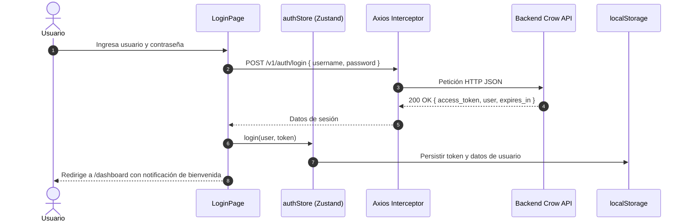

# Autenticación y Control de Acceso (RBAC) — UMG Express Frontend

**Universidad Mariano Gálvez de Guatemala (UMG)**  
**Proyecto Académico — Sistema de Gestión Logística y Paquetería**

---

## 1. Ciclo de Vida de la Autenticación

El control de acceso en el frontend de UMG Express está basado en tokens de autorización de tipo **Bearer**, con almacenamiento seguro en el navegador y control de acceso basado en roles (**Role-Based Access Control - RBAC**).



---

## 2. Almacenamiento y Persistencia de la Sesión

- **Persistencia en `localStorage`:** El almacén global `useAuthStore` persiste las claves:
  - `umg_express_token`: Token Bearer hexadecimal de 64 caracteres.
  - `umg_express_user`: Objeto JSON con ID, nombre completo, nombre de usuario y rol asignado.
- **Inyección Transparente:** La instancia `api/client.ts` agrega automáticamente el encabezado `Authorization: Bearer <token>` a todas las peticiones salientes.
- **Cierre de Sesión (`logout`):** Al accionar el botón de desconexión en la barra superior (`Topbar`), se eliminan las credenciales del almacenamiento local y se reestablece el estado del store, redirigiendo de inmediato a `/login`.

---

## 3. Matriz de Control de Acceso por Roles (RBAC)

El sistema define tres roles principales con responsabilidades y alcances diferenciados:

| Módulo / Funcionalidad | Ruta Frontend | Administrador | Operador | Auditor |
| :--- | :--- | :---: | :---: | :---: |
| **Dashboard Ejecutivo** | `/dashboard` | Permitido | Permitido | Permitido |
| **Emisión de Guías** | `/guias` | Permitido | Permitido | Denegado |
| **Asignación y Despacho** | `/despacho` | Permitido | Permitido | Denegado |
| **Rastreo de Guías** | `/rastreo` | Permitido | Permitido | Permitido |
| **Manifiesto de Carga** | `/manifiesto` | Permitido | Permitido | Permitido |
| **Liquidación Financiera**| `/liquidacion`| Permitido | Denegado | Permitido |
| **CRUD de Sucursales** | `/sucursales` | Permitido | Denegado | Denegado |
| **CRUD de Clientes** | `/clientes` | Permitido | Denegado | Denegado |
| **CRUD de Rutas** | `/rutas` | Permitido | Denegado | Denegado |
| **CRUD de Vehículos** | `/vehiculos` | Permitido | Denegado | Denegado |
| **CRUD de Pilotos** | `/pilotos` | Permitido | Denegado | Denegado |
| **CRUD de Tarifas** | `/tarifas` | Permitido | Denegado | Denegado |
| **CRUD de Usuarios** | `/usuarios` | Permitido | Denegado | Denegado |

---

## 4. Componentes de Protección de Rutas

### 4.1 `ProtectedRoute` (`src/components/layout/ProtectedRoute.tsx`)
Envuelve todas las rutas que requieren autenticación previa:
```tsx
export function ProtectedRoute({ children }: { children: React.ReactNode }) {
  const { isAuthenticated } = useAuthStore();
  const location = useLocation();

  if (!isAuthenticated) {
    return <Navigate to="/login" state={{ from: location }} replace />;
  }

  return <>{children}</>;
}
```

### 4.2 `RoleGuard` (`src/components/layout/RoleGuard.tsx`)
Valida que el rol del usuario activo coincida con los permitidos para la vista solicitada. En caso de discrepancia, presenta una pantalla con código de advertencia `403` y enlace de regreso seguro:
```tsx
export function RoleGuard({ 
  allowedRoles, 
  children 
}: { 
  allowedRoles: ('Administrador' | 'Operador' | 'Auditor')[]; 
  children: React.ReactNode; 
}) {
  const { user } = useAuthStore();

  if (!user || !allowedRoles.includes(user.rol)) {
    return <AccesoRestringidoView rolActual={user?.rol} />;
  }

  return <>{children}</>;
}
```

---

## 5. Adaptabilidad Dinámica del Menú (`Sidebar.tsx`)

El menú lateral filtra en tiempo de renderizado los enlaces y grupos según el rol del usuario en sesión:
- **Administrador:** Visualiza los 4 grupos: *General*, *Operaciones*, *Consultas y Reportes*, y *Mantenimientos*.
- **Operador:** Visualiza *General*, *Operaciones* y *Consultas y Reportes* (sin acceso a liquidación ni mantenimientos).
- **Auditor:** Visualiza *General* y *Consultas y Reportes* (modo lectura y verificación operativa/financiera).

---

## 6. Credenciales de Prueba del Sistema

| Usuario | Contraseña | Rol Asignado | Alcance Principal |
| :--- | :--- | :--- | :--- |
| `admin` | `admin123` | **Administrador** | Control total del sistema, mantenimientos y usuarios |
| `operador` | `operador123` | **Operador** | Emisión de guías, despacho vehicular y rastreo |
| `auditor` | `auditor123` | **Auditor** | Consulta de manifiestos, liquidación financiera y KPIs |
