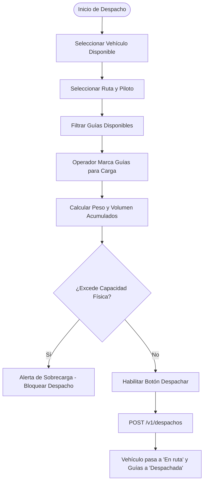

# Control Operativo de Despacho y Carga Vehicular — UMG Express Frontend

**Universidad Mariano Gálvez de Guatemala (UMG)**  
**Proyecto Académico — Sistema de Gestión Logística y Paquetería**

---

## 1. Propósito del Módulo

El módulo de **Despacho** (`src/pages/transacciones/DespachoPage.tsx`) constituye el núcleo operativo de consolidación de envíos. Permite agrupar guías en estado `"Registrada"`, verificar las restricciones físicas del transporte seleccionado y generar el despacho formal con actualización concurrente de inventario y estados.

---

## 2. Flujo de Asignación y Carga

---

## 3. Algoritmo de Verificación de Capacidad

Para cada guía seleccionada $i \in \{1, \dots, k\}$:
$$\text{Peso Acumulado} = \sum_{i=1}^{k} \text{pesoReal}_i$$
$$\text{Volumen Acumulado} = \sum_{i=1}^{k} \text{volumenM3}_i$$

El porcentaje de ocupación se determina como:
$$\%\text{ Ocupación Peso} = \left( \frac{\text{Peso Acumulado}}{\text{capacidadPesoKg}} \right) \times 100$$
$$\%\text{ Ocupación Volumen} = \left( \frac{\text{Volumen Acumulado}}{\text{capacidadVolumenM3}} \right) \times 100$$

### Comportamiento del Componente `CapacityBar`
- **0% a 79% (Seguro):** Barra en tono esmeralda / gris neutro.
- **80% a 99% (Óptimo / Alto):** Barra en tono ámbar de advertencia operativa.
- **100% o superior (Sobrecarga):** Barra en rojo escarlata con bloqueo total del botón de confirmación de despacho.

---

## 4. Transiciones de Estado tras Despacho Exitoso

1. **Guías Despachadas:** Todas las guías asociadas cambian automáticamente su estado a `"Despachada"`.
2. **Vehículo en Ruta:** El vehículo seleccionado cambia su estado operacional a `"En ruta"`, quedando bloqueado para nuevas asignaciones hasta concluir su trayecto.
3. **Generación del Manifiesto:** Se genera el identificador del manifiesto con enlace directo a la vista imprimible de carga.
